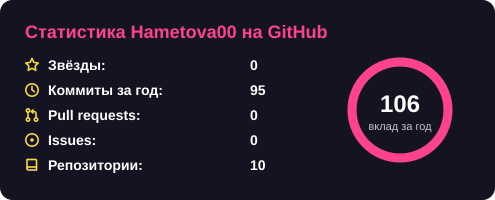
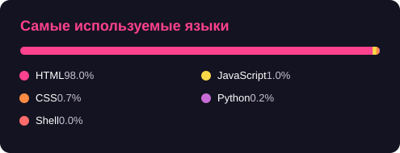
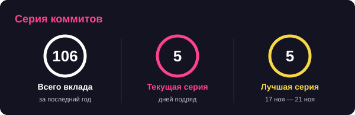

<!-- ══════════ ШАПКА ══════════ -->

  

  

  
  

---

<!-- ══════════ ОБО МНЕ ══════════ -->
## 💻 Обо мне

Занимаюсь разработкой и постоянно пробую что-то новое. Люблю, когда проект не просто работает, а ещё и аккуратно выглядит.

- 🌱 Сейчас изучаю: **Python**, **C#**, **Git**
- 🎮 Делаю свою игру — **Debug Quest**
- 🎯 Цель на год: довести её до релиза
---

<!-- ══════════ СТЕК ══════════ -->
## 🛠 Мой стек

  <picture>
    <source media="(prefers-color-scheme: dark)" srcset="https://skillicons.dev/icons?i=python%2Ccs%2Chtml%2Cgit%2Cvisualstudio&perline=5&theme=dark" />
    
  </picture>

---

<!-- ══════════ ПРОЕКТ ══════════ -->
## 🚧 Сейчас в разработке

<table align="center">
  <tr>
    <td align="center" colspan="2"><b>👾 Debug Quest</b> — <i>пиксельная RPG про то, как устроен компьютер</i></td>
  </tr>
  <tr><td>🎯</td><td>Учит основам информатики через сюжетное приключение</td></tr>
  <tr><td>⚙️</td><td>Готовы пролог, три главы и около 40 мини-игр</td></tr>
  <tr><td>📌</td><td>Дальше — новые главы и задания по Python</td></tr>
  <tr><td>🖥️</td><td>HTML5 + JavaScript, работает в браузере на ПК и телефоне</td></tr>
</table>

---

<!-- ══════════ СТАТИСТИКА ══════════ -->
## 📊 Статистика

  <picture>
    <source media="(prefers-color-scheme: dark)" srcset="https://raw.githubusercontent.com/Hametova00/Hametova00/output/stats-dark.svg" />
    
  </picture>
  <picture>
    <source media="(prefers-color-scheme: dark)" srcset="https://raw.githubusercontent.com/Hametova00/Hametova00/output/langs-dark.svg" />
    
  </picture>

  <picture>
    <source media="(prefers-color-scheme: dark)" srcset="https://raw.githubusercontent.com/Hametova00/Hametova00/output/streak-dark.svg" />
    
  </picture>

  <picture>
    <source media="(prefers-color-scheme: dark)" srcset="https://raw.githubusercontent.com/Hametova00/Hametova00/output/snake-dark.svg" />
    
  </picture>

---

  

