<!-- ════════════════ ШАПКА ════════════════ -->

  

  

  
  
  

---

<!-- ════════════════ ОБО МНЕ ════════════════ -->
## 🌿 Обо мне

Я делаю проекты, в которых есть **настроение** — чтобы было не просто «работает», а *приятно смотреть и пользоваться*.

- 🌱 **Изучаю:** Python, JavaScript, Git
- 🎨 **Вдохновляюсь:** туманными лесами, книгами и тёмной эстетикой
- 🧩 **Люблю:** придумывать идеи и доводить их до красивого результата
- 🎯 **Цель:** выпустить свой первый большой проект
- ☕ **Факт:** *(впиши сюда что-нибудь о себе)*

 

---

<!-- ════════════════ СТЕК ════════════════ -->
## 🛠 Инструменты

  

---

<!-- ════════════════ ПРОЕКТ ════════════════ -->
## 🌫 Сейчас в разработке

<table align="center">
  <tr>
    <td align="center" colspan="2"><b>✨ Название проекта</b> — <i>короткое описание</i></td>
  </tr>
  <tr><td>🎯</td><td>Главная идея проекта</td></tr>
  <tr><td>⚙️</td><td>Что уже готово</td></tr>
  <tr><td>🗺</td><td>Что будет дальше</td></tr>
  <tr><td>🖥</td><td>На чём сделано / где работает</td></tr>
</table>

---

<!-- ════════════════ СТАТИСТИКА ════════════════ -->
## 📊 Статистика

  
  

  

<!-- ════════════════ ЗМЕЙКА ════════════════ -->

  <picture>
    <source media="(prefers-color-scheme: dark)" srcset="https://raw.githubusercontent.com/Hametova00/Hametova00/output/snake.svg" />
    
  </picture>

---

<!-- ════════════════ КОНТАКТЫ ════════════════ -->
## 💌 Связь со мной

  
  
  

  

